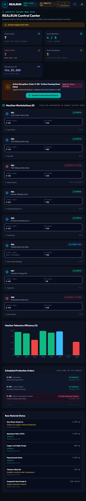

# REALRUN

**Counterfactual decision support for manufacturing operations**

REALRUN is a full-stack prototype for viewing factory state, comparing responses to production disruptions, and recording supervisor-approved decisions. The React dashboard reads orders, machines, materials, disruptions, simulations, analytics, and outcomes from a FastAPI service backed by SQLite. The included seed data is a small example dataset; screens do not use it as a frontend fallback.

All amounts are **Indian Rupees (INR / ₹)**. The dashboard clock, event timestamps, seeded due dates, and decision timestamps use **India Standard Time (IST / Asia/Kolkata, UTC+05:30)**.

> **Prototype notice:** Cost rates, event likelihoods, and seeded production records are demonstration inputs, not verified factory telemetry or financial advice. Replace the sample records and rates with approved plant data before operational use. Decisions remain advisory and require human authorization.

## Screenshots

The included dashboard screenshot shows the seeded synthetic factory data:



## Features

- Database-backed factory overview: orders, workstations, raw materials, risk exposure, and active disruptions.
- A selectable synthetic test-case library covering material delays, machine breakdowns, quality holds, missing tools, and supplier delays.
- Counterfactual scenarios calculated from the selected order, its recorded disruption, and idle machines qualified for that order's material.
- Itemized additive cost model:

  `Expected impact = delay + overtime + setup/movement + logistics + production loss + delivery exposure`

- Recommendation and explanation based on scenario results, with an optional Gemini explanation.
- Decision commits mutate the factory state, resolve non-WAIT disruption events, and save predicted/actual cost records.
- Analytics and outcome history are calculated from saved database records, not fixed chart fixtures.
- The dashboard refreshes its local API data every 30 seconds. This is not a live factory feed; all bundled records are synthetic and reproducible.

## Run locally

Use Python 3.10+ and Node.js 20.19+ or 22.12+. Open two PowerShell terminals in the project folder:

```powershell
cd "C:\Users\uppal\OneDrive\문서\realrun"
```

### Backend

From the project root:

```powershell
# The Python launcher (py) is optional. This project uses the `python` command.
python --version
python -m venv .venv
.\.venv\Scripts\python.exe -m pip install -r requirements.txt

# Optional: replace the old sample data once (this erases saved database records).
.\.venv\Scripts\python.exe -m backend.seed

# Enable the destructive Reset Demo button for this local terminal only.
$env:REALRUN_ENABLE_DEMO_RESET = "true"

# Start the API. Keep this terminal open.
.\.venv\Scripts\python.exe -m uvicorn backend.main:app --host 127.0.0.1 --port 8000 --reload
```

The `tzdata` dependency provides the Asia/Kolkata timezone database on Windows. If the virtual environment already exists, rerun the `pip install -r requirements.txt` command before starting the API.

The API and interactive OpenAPI docs are available at:

- `http://127.0.0.1:8000`
- `http://127.0.0.1:8000/health` (quick connection/data check)
- `http://127.0.0.1:8000/docs`

The sample seeder creates seven orders, eight machines, six materials, five active disruption cases, and six historical outcomes. These synthetic records populate every screen and exercise wait, reroute, expedite, resequence, risk, and history flows.

### Demo test cases

Open **Disruption Center** and select a case-type button to filter the test-case cards. Use **Simulate Decisions** on a card to load that order and event into the simulator. The test cases use seeded database records and deterministic cost assumptions—no external factory connection or live data is needed.

| Test case | Example order | What changes in the simulation |
|---|---|---|
| Material Delay | O-182 | Tests qualified idle-machine rerouting and material-expediting costs. |
| Machine Breakdown | O-401 | Tests maintenance-response costs and an unavailable qualified alternate. |
| Quality Failure | O-428 | Tests inspection/recheck assumptions and quality-hold exposure. |
| Tool Missing | O-145 | Tests approved substitute-tool costs and queue resequencing. |
| Supplier Delay | O-315 | Tests replenishment-expediting costs against the delay exposure. |

Each case has its own affected order, event, risk exposure, and scenario assumptions. The simulator recalculates the four alternatives for the selected case; rerouting is only offered as feasible when an idle workstation is configured for the order's material. The example cost rates are illustrative and should not be treated as operational quotes.

**Seeding/resetting deletes and recreates the SQLite tables.** Do not run `.\.venv\Scripts\python.exe -m backend.seed` against data you need to keep. The API seeds a fresh, empty database on startup. The existing database may still contain older demo records; run the optional seed command once to replace them with the expanded India/IST sample data. Do not run it on normal starts because it erases saved outcomes.

The **Reset Demo** button asks for confirmation and replaces all records in the configured database with the original synthetic sample data. The API reset route is disabled unless `REALRUN_ENABLE_DEMO_RESET=true` (or `1`/`yes`) is set in the backend process environment. Leave this unset outside a disposable local demo. The button will report an error if reset is disabled. A server-side opt-in is not authentication; never enable it on a publicly reachable API.

### Frontend

In another terminal at the project root:

```powershell
# Run once, or whenever package-lock.json changes.
npm ci

# Start the frontend. Keep this terminal open.
npm run dev
```

On later starts run only `npm run dev`. Open the Vite URL printed in the terminal (normally `http://localhost:5173`). To point the frontend to a different API, create a local `.env` file:

```dotenv
VITE_API_BASE_URL=https://your-api.example.com
```

For local development, copy `.env.example` to `.env` if you want to set the API URL explicitly. Restart Vite after changing environment variables. Do not commit `.env` files or API keys.

## Run automated checks

From the project root:

```powershell
npm test
npm run lint
npm run build
.\.venv\Scripts\python.exe -m unittest discover -s tests -p "test_*.py" -v
npm audit --audit-level=high
```

GitHub Actions runs the frontend tests, lint, production build, npm audit, and backend API tests on pushes and pull requests.

## How the demo model works

Scenario costs are additive prototype estimates in INR:

`total = delay + overtime + setup/movement + logistics + production loss + delivery exposure`

- **Delay:** predicted delay minutes × the base ₹4,500 per minute rate.
- **Overtime:** assumed overtime hours × the base ₹24,000 per hour labor rate.
- **Setup/movement:** fixed scenario setup cost or estimated alternate-machine setup cost.
- **Logistics:** scenario-specific expedite or transfer assumption.
- **Production loss:** illustrative flat impact associated with waiting on the event.
- **Delivery exposure:** event risk exposure, applied to the wait scenario when the blocker remains unresolved.

The simulator’s Delay Penalty Weight, Labor Overtime Rate, and Logistics Cost Multiplier scale their respective cost components. They reprice the same four candidate actions; they do not predict a new physical delay, change event data, or invoke the backend again. The cost chart, impact scores, radar cost-contribution chart, lowest-cost action, and its displayed rationale use those adjusted costs. The rationale view reports the active multipliers. These sensitivity values are temporary UI assumptions and are not saved.

The recommended action is the candidate with the lowest estimated total cost. The recommendation is a deterministic ranking, not a trained or validated ML prediction; it does not account for every plant constraint or prove an action is feasible. A recommendation's confidence is explicitly uncalibrated. Scenario delays, flat production-loss values, default rates, and the 3% actual-cost fallback used when committing an outcome are demonstration assumptions. Validate inputs and operational feasibility with qualified staff before any real-world use. Human approval is required.

## Privacy and deployment safety

The sample API does not include user authentication or authorization. CORS only controls browser origins; it does not secure the API. Keep the backend bound to localhost for local demos. Do not expose it publicly with private or production records. Before any public deployment, add authentication and authorization, validate and restrict write operations, use a protected persistent database, configure trusted origins, and keep secrets server-side. Leave `REALRUN_ENABLE_DEMO_RESET` unset for any shared or deployed service. A local reset still erases all rows in the configured database.

## API

| Method | Path | Purpose |
|---|---|---|
| `GET` | `/orders` | List production orders |
| `GET` | `/orders/{order_id}` | Get an order |
| `GET` | `/machines` | List workstations |
| `GET` | `/materials` | List raw materials |
| `GET` | `/disruptions` | List active disruptions |
| `POST` | `/events` | Record a disruption event |
| `GET` | `/assessment/{order_id}` | Get current order/disruption context |
| `POST` | `/simulate/{order_id}` | Calculate counterfactual scenarios |
| `POST` | `/recommend/{order_id}` | Generate a recommendation and explanation |
| `POST` | `/outcomes` | Commit a decision and record its outcome |
| `GET` | `/history/{order_id}` | Read decision history (`all` for every order) |
| `GET` | `/analytics` | Aggregate saved outcome and disruption records |
| `POST` | `/reset-demo` | Destructively reset the database to the sample dataset |

Decision commits without a supplied actual cost use a 3% variance benchmark. This is a prototype assumption, not a measured result.

## GitHub/Vercel deployment

`vercel.json` configures the Vite single-page frontend only. Deploy the FastAPI backend separately to a Python host, then set `VITE_API_BASE_URL` in the frontend deployment to the public backend URL and redeploy the frontend. The sample API has no user authentication; add an appropriate access-control layer before using it with private or production data.

The default database is a local SQLite file at `backend/realrun.db`. Set `REALRUN_DB_PATH` to a file on a persistent mounted volume when deploying; ephemeral/serverless filesystems will lose data on restart. Set `REALRUN_CORS_ORIGINS` to a comma-separated list of trusted frontend origins (for example, `https://your-app.vercel.app`). Keep any Gemini key on the server as `GEMINI_API_KEY`; do not store secrets in the repository.

## Demo flow

1. Start the backend and frontend using the commands above.
2. Review the synthetic sample orders, machine state, active disruption(s), and INR exposure on **Factory Overview**.
3. Open **Disruption Center**, choose a test-case type, and click **Simulate Decisions** on a case.
4. Compare the case-specific wait, reroute, expedite, and resequence estimates in INR.
5. Review the backend-generated recommendation and explanation.
6. Commit a decision to persist the state change and outcome record.
7. Review saved records in **Outcome History** and **Analytics**.
8. Use **Reset Demo** only when you want to discard all current database state and reseed the example dataset; confirm the warning when prompted.
